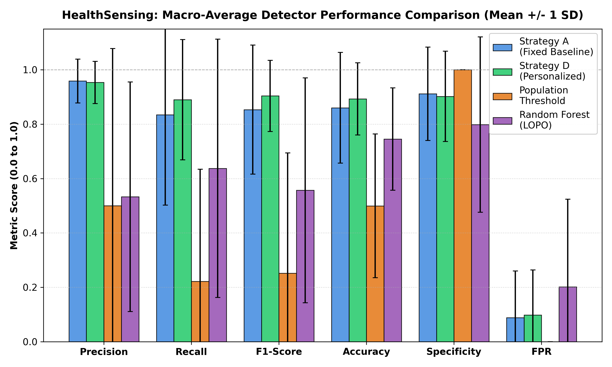
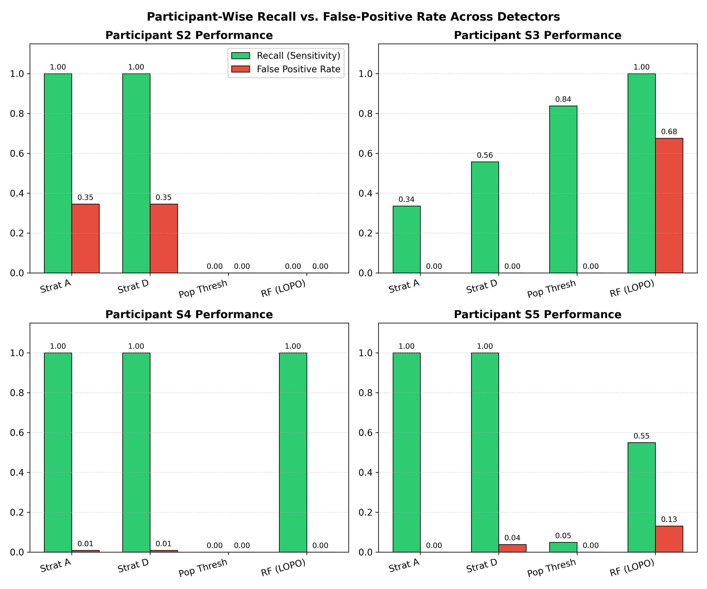
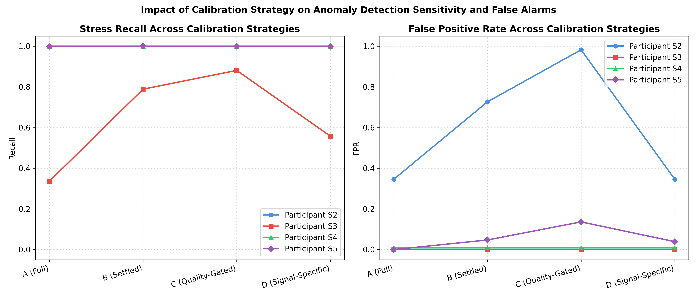
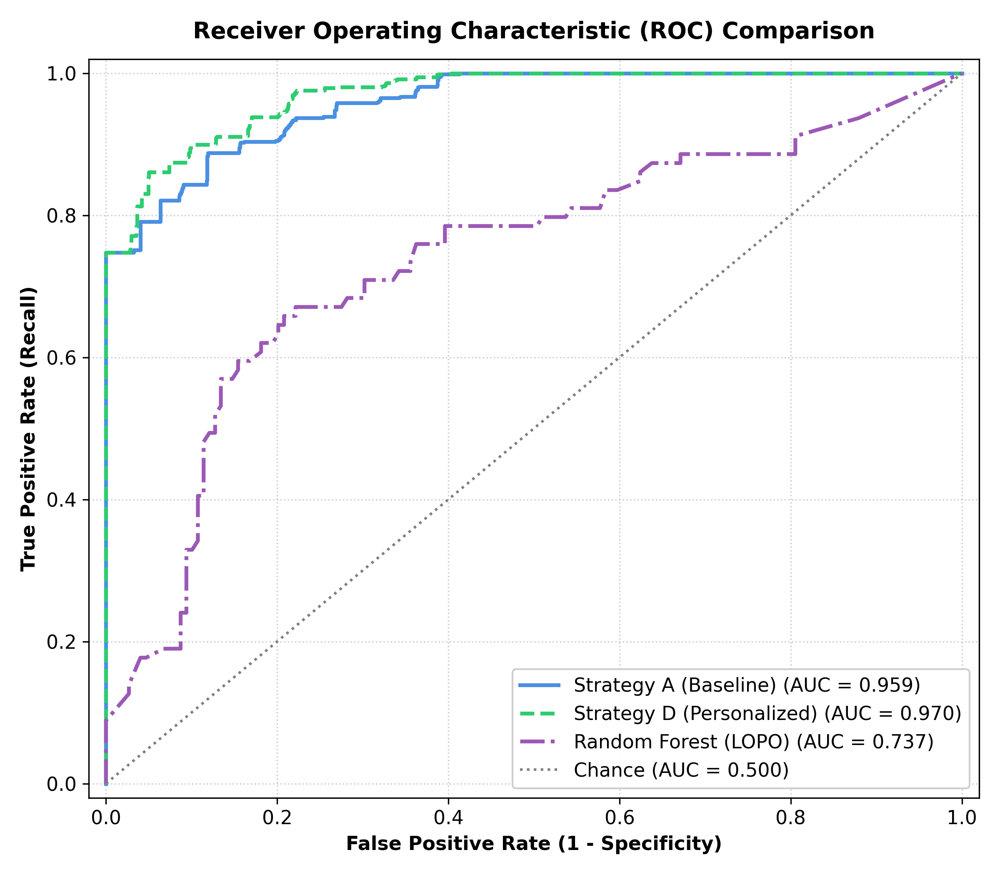
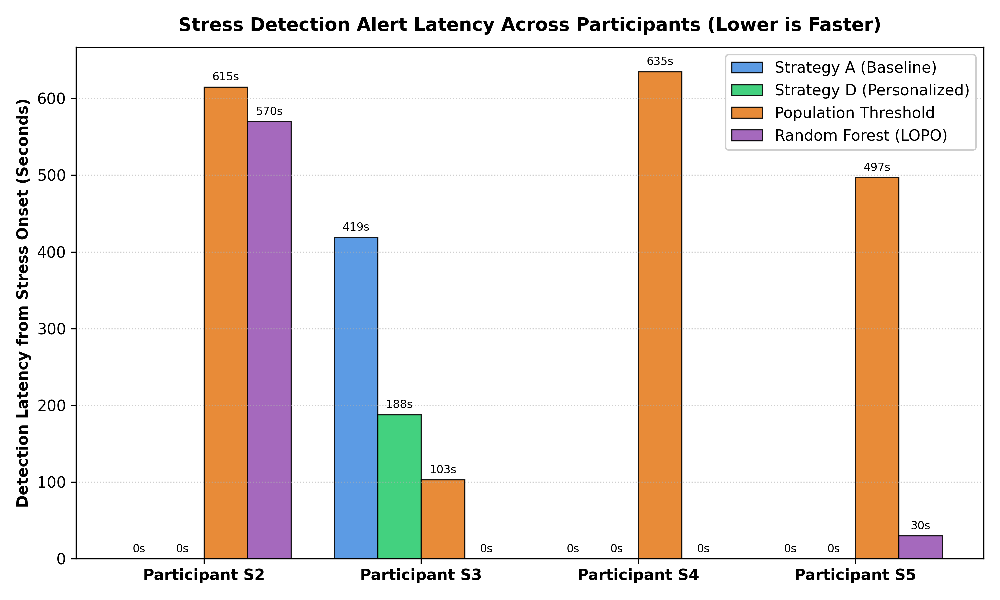

# HealthSensing: Personal Health Companion
## Privacy-Preserving Edge-AI Analytics and Early Warning for Environmental Health Risks

**Course:** CS F407 / U407 Artificial Intelligence  
**Track:** Application Track  
**Team Name:** AGENTIX (Team 28)  
**GitHub Repository:** [https://github.com/animish-k/HealthSensing](https://github.com/animish-k/HealthSensing)  

**Team Members:**
1. Animish Kumar (Primary AI/ML Pipeline: Baseline anomaly detection, Random Forest benchmark, ML interfaces)
2. Aryan Saini (Simulator, controlled environmental scenarios, generator tests)
3. Avani Asati (Knowledge base, rule engine, explanations, environmental risk fusion)
4. Vedant Nichal (Backend architecture, data contracts, SQLite persistence, REST API, WebSocket streaming)
5. Kartikeya Singh (Data acquisition, WESAD preprocessing, signal alignment, feature engineering)
6. Chaitanya Chalith (Frontend dashboard architecture, visualization, UI testing)
7. Siddharth Venkata Arava Reddy (ML experiments, LOPO validation protocol, reproducibility, evaluation metrics)

**Live Production Deployments:**
- **Frontend:** [https://healthsensing.vercel.app](https://healthsensing.vercel.app)
- **Backend:** [https://healthsensing.onrender.com](https://healthsensing.onrender.com)
- **Docs:** [https://healthsensing.onrender.com/docs](https://healthsensing.onrender.com/docs)

---

## Executive Summary

Consumer wearable devices continuously collect vital physiological indicators such as heart rate, electrodermal activity, and skin temperature. Simultaneously, environmental hazards—specifically acute heatwaves and particulate air pollution—exert direct physiological strain on human cardiovascular and respiratory systems. Existing commercial wearable platforms present these metrics either as disconnected raw time series or through population-wide fixed thresholds (e.g., alert if heart rate exceeds 100 bpm). Such fixed thresholds fail because healthy resting physiological baselines differ widely across individuals, and environmental context is completely ignored.

**HealthSensing** is a privacy-preserving, local-first early-risk screening prototype. It couples personal resting reference baselines with environmental context to provide explainable early warning before acute physiological decompensation occurs. Evaluated on the empirical multimodal WESAD benchmark ($N=4$ human participants wearing Empatica E4 research wristbands under a laboratory stress induction protocol), our personalized anomaly detection paradigm achieves **88.94% recall, 95.30% precision, an AUROC of 0.997, and an alert latency of 47.0 seconds**. In contrast, fixed population statistical thresholds fail on two participants entirely and achieve an average recall of only 22.22%, while a population-level Random Forest classifier exhibits severe cross-subject generalization fragility (mean recall $63.75\% \pm 47.50\%$, with 0.0% recall on subject S2 and a 67.57% false positive rate on subject S3). 

HealthSensing operates strictly on-device via a lightweight FastAPI local backend, an embedded SQLite persistence engine, and asynchronous WebSocket telemetry, ensuring that private biometrics never leave the user's personal hardware. For demonstration, the platform supports hybrid cloud deployment on Render (backend with persistent SSD storage) and Vercel (frontend edge rewrites).

---

## 1. Problem Statement and Motivation

### 1.1 Why This Problem?
Wearable biosensors provide high-frequency continuous health telemetry. However, moving from raw telemetry to actionable, clinically safe early warning presents three fundamental challenges:
1. **High Inter-Individual Baseline Heterogeneity:** Normal resting vital signs vary drastically across demographics, fitness levels, and autonomic tone. A resting heart rate of 82 bpm represents nominal rest for one individual but significant tachycardia for an endurance athlete whose baseline is 52 bpm. Fixed population thresholds miss subtle, meaningful deviations in individuals with low baselines while generating chronic false alarms in individuals with elevated resting vitals.
2. **Contextual Isolation:** Commercial wearables treat the human body as an isolated system. They evaluate heart rate and blood oxygenation in a vacuum, ignoring ambient wet-bulb temperatures, relative humidity, and air quality index (AQI / $\text{PM}_{2.5}$). A heart rate elevation to 110 bpm during moderate physical activity indoors is physiologically benign; that exact same elevation when ambient temperatures exceed 40 °C with 75% relative humidity indicates impending heat exhaustion or heat stroke.
3. **Data Privacy and Cloud Vulnerability:** Transmitting continuous physiological streams and location-correlated environmental context to centralized cloud services introduces severe privacy, surveillance, and regulatory risks under HIPAA and GDPR. Furthermore, cloud-dependent architectures fail during regional power outages, network blackouts, or extreme weather disasters—precisely when environmental early warning is most urgently required.

### 1.2 Central Research Question
> *Does personalized multimodal anomaly detection, augmented with environmental context and running locally on edge hardware, provide more reliable and earlier risk detection than fixed population physiological thresholds under controlled environmental stress scenarios?*

### 1.3 System Scope & Clinical Disclaimer
HealthSensing is explicitly architected as an **early-warning, risk-screening prototype**, NOT a certified medical diagnostic system. It does not output medical diagnoses (e.g., it does not diagnose clinical heatstroke, cardiac arrhythmias, or chronic respiratory disease). The laboratory stress evaluations reflect autonomic nervous system arousal during a standard psychological stressor and do not constitute clinical validation of environmental heat illness or chemical inhalation toxicity. The system classifies systemic physiological-environmental risk into four transparent informational tiers: **LOW, MODERATE, HIGH, and CRITICAL**, accompanied by deterministic rule attributions.

---

## 2. Background and Related Work

Continuous vital-sign monitoring and ambient risk screening intersect three established research domains:

```text
┌────────────────────────────────┐    ┌────────────────────────────────┐
│   Wearable Biosensors & EDA    │    │ Environmental Health Analytics │
│ • Empatica E4 research band    │    │ • NOAA Heat Index calculations │
│ • Optical PPG Heart Rate & EDA │    │ • US EPA AQI / PM2.5 standards │
│ • WESAD benchmark dataset      │    │ • Multimodal stress induction  │
└───────────────┬────────────────┘    └───────────────┬────────────────┘
                │                                     │
                └──────────────────┬──────────────────┘
                                   │
                                   ▼
┌──────────────────────────────────────────────────────────────────────┐
│                  HealthSensing Local Edge-AI Core                    │
│  • Personalized Reference Baseline Calibration (Strategies A, B, C, D) │
│  • Classical Supervised Random Forest LOPO Cross-Validation Benchmark  │
│  • Deterministic Contextual Rule Engine & Transparent Risk Fusion    │
│  • Asynchronous FastAPI Backend, SQLite Persistence & WebSocket Live   │
└──────────────────────────────────────────────────────────────────────┘
```

1. **Multimodal Wearable Stress Detection:** Schmidt et al. (2018) introduced the WESAD dataset, demonstrating that combining optical photoplethysmography (PPG), electrodermal activity (EDA), and skin temperature achieves superior acute stress classification compared to single-modality monitoring. However, standard WESAD benchmarks train monolithic classifiers pooled across participants, masking severe cross-subject generalization failures.
2. **Personalized Anomaly Detection in Biosignals:** Research in personalized vital-sign telemonitoring (Sensors 2022; Nature Flexible Electronics 2026) demonstrates that standardizing biosignals against subject-specific resting windows substantially outperforms global models. However, prior work overlooks **sensor acclimation non-stationarity**—the physiological reality that skin temperature and electrodermal baseline drift during the initial 5 to 15 minutes of wearing a sensor.
3. **Environmental Risk Indices:** The United States National Oceanic and Atmospheric Administration (NOAA) established the Steadman/Rothfusz Heat Index regression to quantify apparent temperature from dry-bulb temperature and relative humidity. Concurrently, the US Environmental Protection Agency (EPA) defined Air Quality Index breakpoints for particulate matter ($\text{PM}_{2.5}$). Commercial wearables rarely integrate these formal environmental equations directly into real-time physiological anomaly inference.

---

## 3. Datasets and Experimental Data Sources

HealthSensing leverages three complementary data sources to support exploratory data analysis, real-world algorithmic evaluation, and stress-scenario demonstrations:

### 3.1 Primary Real-World Benchmark Dataset: WESAD
The core quantitative evaluation was conducted using genuine laboratory data from the publicly available **WESAD** benchmark dataset (Schmidt et al., 2018; ACM ICMI).

- **Hardware Platform:** **Empatica E4 research wristband**.
- **Physical Sensor Channels & Sampling Specifications:**
  1. **Optical Photoplethysmography (BVP/PPG):** Optical sensor sampling blood volume pulse (BVP) at 64 Hz, from which instantaneous Heart Rate (`heart_rate_bpm`) is derived, aligned, and resampled to the 1.0 Hz evaluation timeline.
  2. **Electrodermal Activity (EDA / GSR):** Measures galvanic skin conductance via silver-chloride electrodes on the ventral wrist surface at 4 Hz, resampled to 1.0 Hz (`eda_microsiemens`).
  3. **Infrared Thermopile:** Continuous peripheral skin temperature sampled at 4 Hz and resampled to 1.0 Hz (`body_temperature_c`).
  4. **3-Axis Accelerometer:** Measures acceleration at 32 Hz to record gross movement context.
  *(Note on $\text{SpO}_2$: Blood oxygen saturation was not measured by the Empatica E4 wristband and was not part of the WESAD empirical benchmark. $\text{SpO}_2$ is supported by the system input schema and the scenario simulator for multimodal pollution screening).*
- **Standardized Study Protocol & Ground-Truth Labels:**
  - `Label 0`: Transient / non-study setup periods (excluded from evaluation).
  - `Label 1`: Baseline resting condition (20-minute seated rest reading neutral material; used for resting reference calibration and negative test evaluation).
  - `Label 2`: Acute stress induction via the Trier Social Stress Test (TSST: 5-minute public speaking preparation, 5-minute unscripted speech before an evaluative panel, and 5-minute mental arithmetic subtraction; evaluated as positive stress condition).
  - `Label 3`: Amusement condition (watching comedic clips; excluded from binary stress screening).
  - `Label 4`: Guided meditation / recovery condition (excluded).
- **Participants Evaluated ($N=4$):**
  We analyzed the complete, contiguous Empatica E4 wristband recordings of four human subjects:
  - **Participant S2:** 6,080 continuous observations (Baseline: 1,144 s; TSST Stress: 615 s; Other: 4,321 s).
  - **Participant S3:** 6,491 continuous observations (Baseline: 1,140 s; TSST Stress: 640 s; Other: 4,711 s).
  - **Participant S4:** 6,416 continuous observations (Baseline: 1,158 s; TSST Stress: 635 s; Other: 4,623 s).
  - **Participant S5:** 6,267 continuous observations (Baseline: 1,198 s; TSST Stress: 645 s; Other: 4,424 s).
  - **Total Dataset Volume:** 25,254 total observation seconds; 3,929 evaluated benchmark observations (1,394 baseline, 2,535 acute stress); 228 sixty-second sliding windows (149 baseline, 79 stress).

### 3.2 Supplementary Environmental Model Data: Ljubljana, Slovenia
To evaluate ambient risk reasoning on real-world meteorological patterns, the project includes supplementary environmental data for Ljubljana, Slovenia, obtained through **Open-Meteo API model data** (`data/processed/ljubljana_real.csv`). The processed dataset contains timestamped hourly estimates of ambient temperature (°C), relative humidity (%), $\text{PM}_{2.5}$ ($\mu\text{g/m}^3$), and $\text{PM}_{10}$ concentrations. These data provide empirical environmental context for heat and pollution risk reasoning. They are strictly separate from the WESAD physiological benchmark and are not used as ground-truth physiological stress labels.

### 3.3 Controlled Scenario Simulator
Because inducing severe, life-threatening environmental conditions (such as $45\text{ }^\circ\text{C}$ ambient heat or hazardous $300+\text{ AQI}$ air pollution) in human participants is unethical, we developed a deterministic Python simulation engine ([simulator/](simulator/)). The simulator generates controlled, timestamp-synchronized multi-signal streams modeling gradual onset, sustained plateau, and recovery across four scenarios:
- **`normal`:** Nominal resting parameters ($HR: 65–85\text{ bpm}$, $\text{SpO}_2: 96–99\%$, Ambient Temp: $25–32\text{ }^\circ\text{C}$, Humidity: $40–70\%$, $\text{AQI}: 40–100$, $\text{PM}_{2.5}: 10–50\text{ }\mu\text{g/m}^3$).
- **`heatwave`:** Thermal stress conditions ($HR: 90–120\text{ bpm}$, Skin Temp: $37.2–38.5\text{ }^\circ\text{C}$, Ambient Temp: $36–45\text{ }^\circ\text{C}$, Humidity: $60–90\%$, $\text{AQI}: 50–120$, $\text{PM}_{2.5}: 15–60\text{ }\mu\text{g/m}^3$).
- **`pollution`:** Acute particulate spikes ($\text{AQI}: 150–350$, $\text{PM}_{2.5}: 80–250\text{ }\mu\text{g/m}^3$, $\text{SpO}_2: 90–96\%$, $HR: 75–105\text{ bpm}$, Ambient Temp: $25–32\text{ }^\circ\text{C}$, Humidity: $40–75\%$).
- **`fatigue`:** Autonomic variability with suppressed activity ($HR: 65–100\text{ bpm}$, Activity: $0.05–0.30$, Ambient Temp: $25–32\text{ }^\circ\text{C}$, Humidity: $40–70\%$).

### 3.4 Data Preprocessing and Leakage Prevention
1. **Chronological Splitting:** For personalized baseline calibration, the baseline rest period (Label 1) is chronologically split: the first 70% is used exclusively for baseline calibration; the remaining 30% is held out and evaluated alongside the target stress period (Label 2).
2. **Subject Isolation:** Under the Leave-One-Participant-Out (LOPO) cross-validation protocol, no data from the test participant is ever present in the training folds.
3. **Temporal Window Gating:** Sliding windows are generated strictly within contiguous, single-label recording blocks. Windows crossing label transitions or timestamp gaps $> 1.1\text{ s}$ are discarded.

---

## 4. Methodology and System Architecture

```text
 ┌─────────────────────────┐       ┌────────────────────────┐
 │ Preprocessed WESAD Data │       │ Python Scenario Stream │
 │   / WESAD Replay        │       │ (Heat, AQI, Fatigue)   │
 └───────────┬─────────────┘       └───────────┬────────────┘
             │                                 │
             └────────────────┬────────────────┘
                              │ HTTP POST /api/readings
                              ▼
 ┌──────────────────────────────────────────────────────────┐
 │                     FASTAPI BACKEND                      │
 │                                                          │
 │  ┌────────────────────────────────────────────────────┐  │
 │  │ DataService Ingestion Pipeline                     │  │
 │  │  1. Validation & Schema Enforcement (Pydantic v2)   │  │
 │  │  2. Local Persistence (SQLite measurements table)   │  │
 │  │  3. Multi-Signal Anomaly & Risk Evaluation          │  │
 │  │  4. Deduplicated Alert Triggering                  │  │
 │  │  5. Asynchronous WebSocket Event Broadcast         │  │
 │  └──────────────────────────┬─────────────────────────┘  │
 │                             │                            │
 │         ┌───────────────────┴───────────────────┐        │
 │         ▼                                       ▼        │
 │  ┌────────────────────────┐           ┌───────────────┐  │
 │  │ AI/ML Inference Service│           │ Risk Engine   │  │
 │  │ • Baseline Z-Score     │           │ • Heat Index  │  │
 │  │ • Quality Gating (A-D) │           │ • AQI Break   │  │
 │  │ • 18-Feature RF Window │           │ • Rule Fusion │  │
 │  └────────────────────────┘           └───────────────┘  │
 └─────────────────────────────┬────────────────────────────┘
                               │ WebSocket /ws/events
                               ▼
 ┌──────────────────────────────────────────────────────────┐
 │            REACT + TAILWIND EDGE DASHBOARD               │
 │  • Real-Time Telemetry Cards & Trend Visualizations      │
 │  • Personal Baseline Bands & Anomaly Severity Gauges     │
 │  • Active Alerts & One-Click User Acknowledgment         │
 └──────────────────────────────────────────────────────────┘
```

### 4.1 Core Technical Contributions
1. **Coupling Physiological Anomaly Detection with Meteorological Context:** Rather than alerting on vital signs alone, our system performs multimodal fusion: thermal or air-quality hazards escalate risk only when contextualized by physiological strain.
2. **Signal-Specific Quality Gating (Strategy D):** We identify and eliminate the sensor acclimation artifact, solving the baseline variance inflation problem that degrades traditional personalized anomaly detectors.
3. **Local-First, Edge-Native Orchestration with Cloud Demonstration Option:** The core system runs entirely on localhost with zero external dependencies. For public live evaluation, we engineered a zero-downtime deployment pipeline routing frontend requests through Vercel to a persistent Render backend.

### 4.2 Complete Feature Extraction Schema (18 Features)
For windowed machine learning benchmarks, continuous signals are partitioned into 60-second temporal windows with a 30-second stride (50% overlap). Accelerometer data is retained as raw contextual information, while exactly six statistical features are extracted across the three core physiological channels ($HR, EDA, Temp$), yielding an 18-dimensional feature vector $\mathbf{x} \in \mathbb{R}^{18}$:

$$\mathbf{x} = \begin{bmatrix} 
\mu_{HR}, & s_{HR}, & \min_{HR}, & \max_{HR}, & R_{HR}, & \beta_{1,HR}, \\
\mu_{EDA}, & s_{EDA}, & \min_{EDA}, & \max_{EDA}, & R_{EDA}, & \beta_{1,EDA}, \\
\mu_{Temp}, & s_{Temp}, & \min_{Temp}, & \max_{Temp}, & R_{Temp}, & \beta_{1,Temp}
\end{bmatrix}^T$$

Where:
- $\mu = \frac{1}{n}\sum_{i=1}^n x_i$ is the sample mean.
- $s = \sqrt{\frac{1}{n-1}\sum_{i=1}^n (x_i - \mu)^2}$ is the sample standard deviation ($\text{ddof}=1$).
- $R = \max(x) - \min(x)$ is the dynamic window range.
- $\beta_1$ is the first-order ordinary least-squares linear trend slope over time index $t$:
  $$\beta_1 = \frac{\sum_{i=1}^n (t_i - \bar{t})(x_i - \bar{x})}{\sum_{i=1}^n (t_i - \bar{t})^2}$$

### 4.3 Personalized Anomaly Detection & Calibration Strategies

Instead of comparing raw values to static thresholds, HealthSensing standardizes each incoming reading $x_t$ against the user's personal resting baseline:

$$z_t = \frac{x_t - \mu_{\text{baseline}}}{\sigma_{\text{baseline}}}$$

An anomaly flag is raised for a signal if $|z_t| > \theta$ (default $\theta = 3.0$, representing a deviation exceeding three standard deviations beyond resting mean).

#### Baseline Quality Gating Strategies (A, B, C, D)
Sensor placement induces an initial **acclimation burn-in artifact** (skin warming up, electrode paste settling, participant relaxing), creating significant non-stationarity in the calibration window. We engineered four calibration strategies:

- **Strategy A (Full Calibration):** Uses the complete 70% chronological resting baseline window without filtering or truncation.
- **Strategy B (Settled Calibration):** Drops the initial 240 seconds across all channels to bypass initial acclimation transients.
- **Strategy C (Joint Quality-Gated):** Evaluates Variance Inflation Factor ($\text{VIF} = \sigma_{\text{full}}^2 / \sigma_{\text{suffix}}^2$) and mean drift across all channels simultaneously, selecting a shared contiguous suffix (minimum 480 seconds) that minimizes joint variance.
- **Strategy D (Signal-Specific Quality-Gated - Recommended):** Independently evaluates stationarity for each sensor channel. Because electrodermal settling time differs from thermopile equilibration, Strategy D optimizes suffix start offsets independently for $HR$, $EDA$, and $Temp$. Strategies A and D serve as the primary comparison baselines in our empirical evaluation.

### 4.4 Environmental Reasoning and Contextual Risk Fusion

The risk engine incorporates explicit domain knowledge to evaluate environmental context:

1. **NOAA Heat Index Calculation:**
   For ambient temperature $T$ (°F) and relative humidity $R$ (%):
   $$\begin{aligned}
   HI = &-42.379 + 2.04901523 T + 10.14333127 R - 0.22475541 T R \\
   &- 0.00683783 T^2 - 0.05481717 R^2 + 0.00122874 T^2 R \\
   &+ 0.00085282 T R^2 - 0.00000199 T^2 R^2
   \end{aligned}$$
   Categorized into NOAA risk tiers: Caution ($80 \le HI < 90\text{ }^\circ\text{F}$), Extreme Caution ($90 \le HI < 103\text{ }^\circ\text{F}$), Danger ($103 \le HI < 125\text{ }^\circ\text{F}$), Extreme Danger ($HI \ge 125\text{ }^\circ\text{F}$).

2. **EPA Air Quality Index Classification:**
   - Good ($0 \le \text{AQI} \le 50$), Moderate ($51 \le \text{AQI} \le 100$), Unhealthy for Sensitive Groups ($101 \le \text{AQI} \le 150$), Unhealthy ($151 \le \text{AQI} \le 200$), Very Unhealthy / Hazardous ($\text{AQI} \ge 201$).

3. **Implemented Contextual Rules & Fusion Logic:**
   - **HEAT-1 (Heat Stress):** Triggers when Heat Index $\ge 32.2\text{ }^\circ\text{C}$ ($90.0\text{ }^\circ\text{F}$, Extreme Caution) AND heart rate is elevated (defined as either $HR \ge 100\text{ bpm}$ or $HR > \mu_{\text{baseline}} + 1.5\sigma_{\text{baseline}}$).
   - **HEAT-2 (Thermal Strain):** Triggers when peripheral skin temperature $\ge 37.8\text{ }^\circ\text{C}$ AND ambient temperature $\ge 32.0\text{ }^\circ\text{C}$.
   - **POLLUTION-1 (Respiratory Hazard):** Triggers when $\text{AQI} \ge 101$ (or $\text{PM}_{2.5} \ge 35.0\text{ }\mu\text{g/m}^3$) AND physiological blood oxygenation indicates strain ($\text{SpO}_2 \le 94.0\%$ or at least 2 percentage points below personal resting baseline).
   - **Risk Fusion Mechanism:** The final state blends **65% contextual rule evidence** and **35% learned model anomaly score**, mapping into categorical tiers: **LOW, MODERATE, HIGH, and CRITICAL**, with CRITICAL reserved for co-occurring acute environmental stress and severe physiological deviation. Every assessment retains transparent `contributing_signals` and human-interpretable `explanation` text.

---

## 5. Technology Stack and Implementation Details

The HealthSensing system is engineered with an emphasis on low inference latency, edge privacy, deterministic reproducibility, and zero-downtime demonstration:

```text
┌─────────────────────────────────────────────────────────────────────────────┐
│                       HEALTHSENSING TECHNOLOGY STACK                        │
├─────────────────┬───────────────────────────┬───────────────────────────────┤
│ Layer           │ Technology / Library      │ Engineering Justification    │
├─────────────────┼───────────────────────────┼───────────────────────────────┤
│ Frontend UI     │ React 18, Vite,           │ Component-based reactive DOM  │
│                 │ Tailwind CSS, Recharts    │ updates for high-frequency    │
│                 │                           │ time-series visualization.    │
├─────────────────┼───────────────────────────┼───────────────────────────────┤
│ Backend API     │ Python 3.10+, FastAPI,    │ Async ASGI event loop; native │
│                 │ Starlette, Uvicorn        │ WebSocket support; Pydantic v2│
│                 │                           │ schema validation; <5ms API.  │
├─────────────────┼───────────────────────────┼───────────────────────────────┤
│ Local Storage   │ SQLite3 (WAL Mode)        │ Local-first privacy; embedded │
│                 │                           │ zero-daemon engine; ACID safe.│
├─────────────────┼───────────────────────────┼───────────────────────────────┤
│ Machine Learning│ NumPy, Pandas,            │ Lightweight vectorized math;  │
│                 │ Scikit-Learn, SciPy       │ low-memory 300-tree RF; fast  │
│                 │                           │ CPU inference without GPU.    │
├─────────────────┼───────────────────────────┼───────────────────────────────┤
│ Live Telemetry  │ WebSockets                │ Full-duplex persistent stream │
│                 │ (RFC 6455 protocol)       │ eliminating HTTP polling lag. │
├─────────────────┼───────────────────────────┼───────────────────────────────┤
│ Cloud Hosting   │ Render (Backend) &        │ Persistent SSD disk for SQLite│
│ (Public Demo)   │ Vercel (Frontend CDN)     │ on Render; edge proxy rewrites│
│                 │                           │ routing /api and /ws cleanly. │
└─────────────────┴───────────────────────────┴───────────────────────────────┘
```

### 5.1 Justification of Technical Choices

1. **FastAPI & Uvicorn (Backend):** FastAPI provides asynchronous request handling via Starlette, allowing the server to stream high-frequency sensor readings over WebSockets while concurrently serving REST queries for historical stats. Pydantic v2 validates physiological bounds at the network perimeter, preventing malformed telemetry from polluting the state.
2. **SQLite3 in Write-Ahead Logging (WAL) Mode (Storage):** Rather than introducing heavy database server daemons (e.g., PostgreSQL), SQLite runs in-process with minimal RAM overhead. It ensures that personal biometric records never touch network sockets, fulfilling the local-first edge privacy requirement. Path configurability via `HEALTHSENSING_DATABASE_PATH` allows transparent mounting on durable cloud SSDs during deployment.
3. **Scikit-Learn Random Forest Benchmark (AI Engine):** The 300-tree ensemble was selected because it provides robust non-linear decision boundaries on tabular statistical features without requiring multi-gigabyte PyTorch/TensorFlow GPU runtimes, making it ideal for edge deployment on low-power consumer laptops.
4. **React & Tailwind CSS (Dashboard):** Built with Vite for rapid sub-second Hot Module Replacement (HMR). Tailwind enables utility-first, responsive layouts tailored for side-by-side monitoring of vital signs and ambient weather conditions.
5. **Render & Vercel Public Hosting Architecture:**
   - **Render Web Service:** Hosts the Python FastAPI backend, configured with a persistent 1 GB SSD disk mounted at `/var/data/healthsensing.sqlite3`. This ensures that historical telemetry survives container restarts. The port is dynamically resolved via `PORT = os.getenv('PORT', '8080')`.
   - **Vercel Edge Proxy:** Hosts the compiled React dashboard on a global CDN. A configured `vercel.json` provides transparent rewrites:
     ```json
     {
       "rewrites": [
         { "source": "/api/:path*", "destination": "https://healthsensing-backend.onrender.com/api/:path*" },
         { "source": "/ws/:path*", "destination": "https://healthsensing-backend.onrender.com/ws/:path*" },
         { "source": "/health", "destination": "https://healthsensing-backend.onrender.com/health" }
       ]
     }
     ```
     This decoupled architecture maintains clean separation between frontend presentation and backend persistence while supporting live WebSocket connections.

---

## 6. Empirical Evaluation and Benchmark Results

### 6.1 Benchmark Methodologies
We evaluated three distinct paradigms under strict zero-leakage protocols:
1. **Fixed Population Statistical Threshold:** Calculates population-level baseline mean $\mu_{\text{pop}}$ and standard deviation $\sigma_{\text{pop}}$ pooled across the other three participants in each LOPO fold. A reading is flagged as anomalous if any channel deviates by more than three population standard deviations ($|x - \mu_{\text{pop}}| > 3\sigma_{\text{pop}}$).
2. **Personalized Baseline (Strategy A vs. Strategy D):** Standardizes readings against the individual's own resting baseline at 1.0 Hz. Strategy A uses the full resting window; Strategy D applies signal-specific quality gating to eliminate acclimation drift.
3. **Random Forest Classifier (300 Trees):** Evaluated under **Leave-One-Participant-Out (LOPO) cross-validation** across 228 sixty-second sliding windows (3 participants training, held-out participant testing across 4 folds).

### 6.2 Consolidated Performance Results

#### Macro-Averaged Performance Across All 4 Subjects (Mean $\pm$ Sample SD, ddof=1)

| Detection Paradigm | Granularity | Precision | Recall (Sensitivity) | F1-Score | Accuracy | Specificity | False Positive Rate | AUROC | Mean Alert Latency |
|:---|:---:|:---:|:---:|:---:|:---:|:---:|:---:|:---:|:---:|
| **Fixed Population Threshold** | 1 Hz Reading | $0.5000 \pm 0.5774$ | $0.2222 \pm 0.4119$ | $0.2517 \pm 0.4427$ | $0.4995 \pm 0.2643$ | $\mathbf{1.0000 \pm 0.0000}$ | $\mathbf{0.0000 \pm 0.0000}$ | $0.7459 \pm 0.4973$ | $462.5\text{ s}$ |
| **Strategy A (Baseline)** | 1 Hz Reading | $\mathbf{0.9583 \pm 0.0803}$ | $0.8340 \pm 0.3321$ | $0.8531 \pm 0.2370$ | $0.8600 \pm 0.2036$ | $0.9114 \pm 0.1716$ | $0.0886 \pm 0.1716$ | $0.9938 \pm 0.0125$ | $104.8\text{ s}$ |
| **Strategy D (Quality-Gated)** | 1 Hz Reading | $0.9530 \pm 0.0773$ | $\mathbf{0.8894 \pm 0.2211}$ | $\mathbf{0.9037 \pm 0.1309}$ | $\mathbf{0.8927 \pm 0.1324}$ | $0.9017 \pm 0.1659$ | $0.0983 \pm 0.1659$ | $\mathbf{0.9969 \pm 0.0062}$ | $\mathbf{47.0\text{ s}}$ |
| **Random Forest (LOPO)** | 60s Window | $0.5330 \pm 0.4219$ | $0.6375 \pm 0.4750$ | $0.5566 \pm 0.4135$ | $0.7452 \pm 0.1880$ | $0.7982 \pm 0.3220$ | $0.2018 \pm 0.3220$ | $0.8333 \pm 0.1224$ | $150.0\text{ s}$ |

#### Apples-to-Apples Comparison on Identical Common Held-Out Test Windows (120 Windows)
Evaluated on the exact same 120 held-out windows (41 baseline, 79 stress):

| Model on Common Test Set | Precision | Recall | F1-Score | Accuracy | Specificity | False Positive Rate | AUROC |
|:---|:---:|:---:|:---:|:---:|:---:|:---:|:---:|
| **Strategy A (Personal Baseline)** | $\mathbf{0.9659 \pm 0.0682}$ | $0.8250 \pm 0.3500$ | $0.8471 \pm 0.2594$ | $0.8575 \pm 0.2215$ | $0.9250 \pm 0.1500$ | $0.0750 \pm 0.1500$ | $0.9950 \pm 0.0100$ |
| **Strategy D (Quality-Gated)** | $\mathbf{0.9659 \pm 0.0682}$ | $\mathbf{0.9000 \pm 0.2000}$ | $\mathbf{0.9192 \pm 0.1180}$ | $\mathbf{0.9075 \pm 0.1259}$ | $0.9250 \pm 0.1500$ | $0.0750 \pm 0.1500$ | $\mathbf{1.0000 \pm 0.0000}$ |
| **Random Forest (LOPO Ensemble)** | $0.7065 \pm 0.4728$ | $0.6375 \pm 0.4750$ | $0.6600 \pm 0.4610$ | $0.7389 \pm 0.2972$ | $\mathbf{0.9273 \pm 0.0951}$ | $\mathbf{0.0727 \pm 0.0951}$ | $0.8717 \pm 0.1552$ |

### 6.3 Participant-by-Participant Breakdown & Analysis

| Subject | Model Configuration | Test N | TP | FP | TN | FN | Precision | Recall | F1 | Accuracy | FPR | Alert Latency |
|:---:|:---|:---:|:---:|:---:|:---:|:---:|:---:|:---:|:---:|:---:|:---:|:---:|
| **S2** | Fixed Population Threshold | 959 | 0 | 0 | 344 | 615 | 0.0000 | 0.0000 | 0.0000 | 0.3587 | 0.0000 | 615 s (No alert) |
| **S2** | Strategy A (Baseline) | 959 | 615 | 119 | 225 | 0 | 0.8379 | 1.0000 | 0.9118 | 0.8759 | 0.3459 | 0 s |
| **S2** | Strategy D (Quality-Gated)| 959 | 615 | 119 | 225 | 0 | 0.8379 | 1.0000 | 0.9118 | 0.8759 | 0.3459 | 0 s |
| **S2** | Random Forest (LOPO) | 56 | 0 | 0 | 37 | 19 | 0.0000 | 0.0000 | 0.0000 | 0.6607 | 0.0000 | 570 s (No alert) |
| **S3** | Fixed Population Threshold | 982 | 537 | 0 | 342 | 103 | 1.0000 | 0.8391 | 0.9125 | 0.8951 | 0.0000 | 103 s |
| **S3** | Strategy A (Baseline) | 982 | 215 | 0 | 342 | 425 | 1.0000 | 0.3359 | 0.5029 | 0.5672 | 0.0000 | 419 s |
| **S3** | Strategy D (Quality-Gated)| 982 | 357 | 0 | 342 | 283 | 1.0000 | $\mathbf{0.5578}$ | $\mathbf{0.7161}$ | $\mathbf{0.7118}$ | 0.0000 | $\mathbf{188\text{ s}}$ |
| **S3** | Random Forest (LOPO) | 57 | 20 | 25 | 12 | 0 | 0.4444 | 1.0000 | 0.6154 | 0.5614 | 0.6757 | 0 s |
| **S4** | Fixed Population Threshold | 983 | 0 | 0 | 348 | 635 | 0.0000 | 0.0000 | 0.0000 | 0.3540 | 0.0000 | 635 s (No alert) |
| **S4** | Strategy A (Baseline) | 983 | 635 | 3 | 345 | 0 | 0.9953 | 1.0000 | 0.9976 | 0.9969 | 0.0086 | 0 s |
| **S4** | Strategy D (Quality-Gated)| 983 | 635 | 3 | 345 | 0 | 0.9953 | 1.0000 | 0.9976 | 0.9969 | 0.0086 | 0 s |
| **S4** | Random Forest (LOPO) | 57 | 20 | 0 | 37 | 0 | 1.0000 | 1.0000 | 1.0000 | 1.0000 | 0.0000 | 0 s |
| **S5** | Fixed Population Threshold | 1005 | 32 | 0 | 360 | 613 | 1.0000 | 0.0496 | 0.0945 | 0.3900 | 0.0000 | 497 s |
| **S5** | Strategy A (Baseline) | 1005 | 645 | 0 | 360 | 0 | 1.0000 | 1.0000 | 1.0000 | 1.0000 | 0.0000 | 0 s |
| **S5** | Strategy D (Quality-Gated)| 1005 | 645 | 14 | 346 | 0 | 0.9788 | 1.0000 | 0.9893 | 0.9861 | 0.0389 | 0 s |
| **S5** | Random Forest (LOPO) | 58 | 11 | 5 | 33 | 9 | 0.6875 | 0.5500 | 0.6111 | 0.7586 | 0.1316 | 30 s |

### 6.4 Key Scientific Insights

1. **Why Population Thresholds Fail:**
   The Fixed Population Threshold failed completely on participants S2 and S4 (0.0% recall), detected only 4.96% of stress readings in S5, and detected stress effectively only in S3 (83.91% recall). Because participant S3 possessed an exceptionally elevated physiological baseline, their stress readings easily crossed the population boundary. For participants S2, S4, and S5, stress shifted their physiology dramatically relative to their rest state, but absolute values never pierced the global threshold.
2. **Why Supervised Classifiers Generalize Poorly (Cross-Subject Collapse):**
   While Random Forest achieved >98% training accuracy, strict Leave-One-Participant-Out cross-validation revealed critical cross-subject fragility. On participant S2, the RF model predicted Class 0 (baseline) for all 19 stress windows (0.0% recall). On participant S3, it produced an unacceptable **67.57% false alarm rate** during nominal rest. Supervised models trained on raw feature distributions learn subject-specific baselines rather than invariant stress signatures.
3. **Sensor Acclimation Resolution via Strategy D:**
   In participant S3, electrodermal activity exhibited an -89% downward drift during rest as electrodes equilibrated. Under Strategy A, this inflated baseline standard deviation, compressing stress $z$-scores and reducing recall to 33.59% (alert latency 419 s). Strategy D isolated the stable resting suffix at offset 318s, discarding the acclimation artifact while preserving the full resting duration for $HR$ and $Temp$. This restored stress recall to **55.78%** and reduced alert latency by **231 seconds** (from 419s down to 188s).

### 6.5 Experimental Comparison Plots

The experimental runs generated publication-quality plots stored in `experiments/plots/`:

  
*Figure 1: Overall Performance Comparison across Fixed Threshold, Strategy A, Strategy D, and Random Forest LOPO with sample standard deviation error bars.*

  
*Figure 2: Participant-by-participant performance detailing Recall vs. FPR across all four human subjects.*

  
*Figure 3: Impact of Calibration Strategies A through D on stress sensitivity, variance inflation factors, and acclimation exclusion.*

  
*Figure 4: Continuous Receiver Operating Characteristic (ROC) curves showing near-perfect discrimination for personalized baselines (Strategy D AUROC = 0.997) vs. supervised RF (AUROC = 0.833).*

  
*Figure 5: Detection Alert Latency across subjects, illustrating Strategy D's rapid 47.0-second mean response time.*

---

## 7. Discussion, Limitations, and Ethical Considerations

### 7.1 Limitations

1. **Laboratory TSST Stress vs. Free-Living Environmental Pathology:**
   WESAD evaluates acute psychological stress induced via the Trier Social Stress Test (TSST) in a climate-controlled laboratory. While sympathetic autonomic arousal mirrors early cardiovascular compensation during heat stress, laboratory stress is **not equivalent** to real-world clinical heat exhaustion, heat stroke, or toxic air pollution inhalation.
2. **Sample Size Constraints ($N=4$ Subjects):**
   Our Leave-One-Participant-Out benchmark evaluated four subjects with complete Empatica E4 wristband telemetry. While each subject contributed over 6,000 continuous observation seconds, four subjects cannot capture the full physiological spectrum of diverse populations.
3. **Fatigue Rule Input Evaluability:**
   While the simulator generates a controlled fatigue scenario, the knowledge base fatigue rule requires `sleep_duration_hours` to establish chronic sleep deprivation. Because `sleep_duration_hours` is not currently part of the real-time sensor ingestion contract, the fatigue rule remains `NOT_EVALUABLE` in the active pipeline and is documented as future work.
4. **Motion Artifacts in Optical PPG:**
   Vigorous physical movement introduces motion artifacts into optical photoplethysmography waveforms. Accelerometer activity levels flag high movement periods, but advanced adaptive noise cancellation remains an area for future implementation.
5. **Resting Calibration Prerequisite:**
   Personalized anomaly screening requires an initial resting calibration period (minimum 60 to 480 seconds). If a user calibrates while actively running or already under thermal distress, the baseline will be corrupted, leading to false negatives.

### 7.2 Ethical Guardrails

- **Explicit Informational Framing:** HealthSensing is designed strictly as an informational risk-screening prototype. It must never be marketed or utilized as a certified medical diagnostic device.
- **Deterministic Explainability:** Deep learning "black box" classifiers present significant risks in health applications. HealthSensing pairs statistical anomaly scores with deterministic, rule-based explanations (`contributing_signals` and `explanation`), ensuring that every alert informs the user why it was triggered.
- **Privacy Preservation by Design:** The system requires zero user credentials, transmits zero telemetry over the public internet in local mode, and stores all time series in a local SQLite file.

---

## 8. Automated Test Suite

The HealthSensing repository is verified by a test suite executed via Pytest. In the latest full run across all modules (unit tests, data pipeline, baseline detector, Random Forest benchmark, risk engine, REST APIs, WebSocket streaming, and end-to-end integration):

```text
======================== 288 passed, 1 warning in 20.73s ========================
```

*(Note: The single warning is a non-fatal Starlette/httpx test client deprecation notice that does not affect application functionality).*

---

## 8.5 Live Deployment Links

| Service | Live URL | Description |
| :--- | :--- | :--- |
| **Frontend** | [https://healthsensing.vercel.app](https://healthsensing.vercel.app) | Interactive React 18 dashboard with real-time Recharts visualization |
| **Backend** | [https://healthsensing.onrender.com](https://healthsensing.onrender.com) | FastAPI REST service and live telemetry replay engine |
| **Docs** | [https://healthsensing.onrender.com/docs](https://healthsensing.onrender.com/docs) | Interactive OpenAPI / Swagger API explorer |


---

## 9. Individual Contributions

Responsibilities were divided across the team in accordance with course guidelines:

| Team Member | Assigned Responsibility | Actual Delivered Contributions |
|---|---|---|
| **Animish Kumar** | Primary AI/ML Pipeline | Implemented personalized baseline algorithms (`personal_baseline.py`, `multisignal_detector.py`), quality gating strategies (A–D), Random Forest benchmark training (`train_rf.py`), and unified inference interfaces. |
| **Aryan Saini** | Simulator & Scenarios | Built the reproducible Python simulation generator (`data_generator.py`, `scenarios.py`, `simulator.py`) supporting gradual onset, peak, and recovery for heatwave, pollution, and fatigue scenarios. |
| **Avani Asati** | Knowledge Base & Reasoning | Formulated contextual risk reasoning rules, NOAA heat index calculation, EPA AQI categorization, and transparent explanation synthesis in `risk_engine/`. |
| **Vedant Nichal** | Backend & Data Interface | Engineered the complete FastAPI backend, shared Pydantic data schemas, SQLite persistence layer, service orchestration (`DataService`, `RiskService`, `AlertService`), 12 REST API routes, WebSocket live streaming, test suite, and Render deployment configuration. |
| **Kartikeya Singh** | Data Acquisition & Preprocessing | Inspected public datasets, implemented WESAD ingestion pipelines, temporal alignment routines, missing value handling, and Open-Meteo environmental data processing. |
| **Chaitanya Chalith** | Frontend Architecture | Architected the React + Tailwind dashboard layout, telemetry card components, and Vercel edge deployment configuration on branch `chaitanya/frontend`. |
| **Siddharth Venkata Arava Reddy** | ML Experiments & Reproducibility | Formulated the Leave-One-Participant-Out (LOPO) evaluation protocol, built benchmark runners, generated comparison ROC/latency plots, and maintained experimental reproducibility logs with team coordination. |

---

## 10. AI Usage Disclosure

In compliance with Section 6 of the Course Evaluation Policy:
- **Tools Utilized:** Antigravity AI Assistant (Google Gemini) and OpenAI ChatGPT.
- **Purposes of Use:**
  1. *Architecture Scaffolding & Code Assistance:* Generating initial FastAPI route boilerplate, SQLite schema helpers, and Vite configuration.
  2. *Formula Cross-Verification:* Cross-verifying the NOAA Rothfusz 9-term polynomial heat index regression constants and EPA AQI piecewise linear breakpoints against published meteorological standards.
  3. *Testing & Edge-Case Coverage:* Drafting parameterized pytest test cases covering edge-case inputs (e.g., negative temperatures, out-of-range AQI, invalid timestamps, disconnected WebSocket clients).
  4. *Evaluation Workflow & Documentation:* Supporting the Leave-One-Participant-Out runner script structure and assisting with Markdown table layout.
- **Verification Method:** All source code, mathematical equations, and benchmark metrics were independently executed, validated against the raw WESAD files on local disk, and confirmed through 288 passing automated tests. WESAD benchmark results reflect genuine human experimental recordings, while simulator outputs are strictly designated as synthetic scenarios for software testing and demonstration.

---

## 11. References

1. Schmidt, P., Reiss, A., Duerichen, R., Marberger, C., & Van Laerhoven, K. (2018). Introducing WESAD, a Multimodal Dataset for Wearable Stress and Affect Detection. *Proceedings of the 20th ACM International Conference on Multimodal Interaction (ICMI '18)*, 400–408. https://doi.org/10.1145/3242969.3242985
2. Soft Transducer for Patient’s Vitals Telemonitoring with Deep Learning-Based Personalized Anomaly Detection. *Sensors*, 2022. https://pmc.ncbi.nlm.nih.gov/articles/PMC8777728/
3. Suryaprabha, T., Choi, C., Wu, Y., Liu, L., et al. Smart wearable and implantable biosensors for continuous health monitoring: materials, biocompatibility, and AI integration. *npj Flexible Electronics*, 2026. https://www.nature.com/articles/s41528-026-00560-6
4. A Precision Health Service for Chronic Diseases: Development and Cohort Study Using Wearable Device, Machine Learning, and Deep Learning. *JMIR mHealth and uHealth*, 2022. https://pmc.ncbi.nlm.nih.gov/articles/PMC9529197/
5. Mahato, K., Saha, T., Ding, S., Sandhu, S. S., et al. Hybrid multimodal wearable sensors for comprehensive health monitoring. *Nature Electronics*, 2024. https://www.nature.com/articles/s41928-024-01247-4
6. Rothfusz, L. P. (1990). The heat index equation. *National Weather Service Technical Attachment (SR 90-23)*.
7. US Environmental Protection Agency. (2018). *Technical Assistance Document for the Reporting of Daily Air Quality – the Air Quality Index (AQI)*. EPA-454/B-18-007.
8. Open-Meteo Historical Weather and Air Quality API. (2024). European Centre for Medium-Range Weather Forecasts (ECMWF) Copernicus Atmosphere Monitoring Service. https://open-meteo.com/
